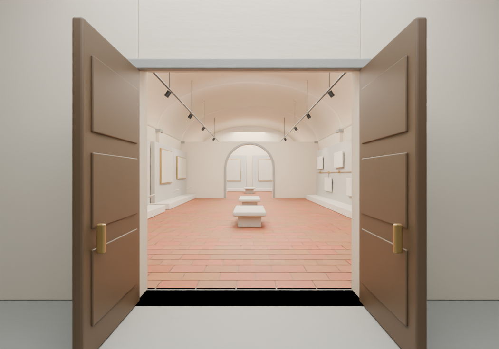

# Galleria Beato Angelico

Progetto Blender di una mostra virtuale, con sala principale e sala per il confronto tra opere.

## Contenuto

- `Galleria_Beato_Angelico.blend`: scena modificabile, con portone aperto, volte, pannelli espositivi, linea del tempo vuota e sala del confronto.
- `Visita_galleria.py`: navigazione con collisioni su muri e arredi.
- `Avvia_visita.cmd`: avvio della visita su Windows con Blender 5.1.
- `Come_esplorare.txt`: istruzioni complete.
- `Anteprima_*.png`: viste della galleria.

## Avvio

Scarica il progetto con **Code > Download ZIP**, estrai tutti i file nella stessa cartella e apri `Avvia_visita.cmd`.

Usa **W A S D** per camminare, il **mouse** per guardare, **Shift** per accelerare ed **Esc** per terminare. La visita parte dalla pedana esterna ed entra attraverso il portone.

Se apri direttamente il file Blender, esegui il testo interno `Visita_galleria.py` dall'area di lavoro Scripting. Il pannello **Visita** nella barra laterale della vista 3D consente di riavviare il percorso.

## Stato del progetto

La struttura contiene alloggiamenti vuoti: opere, testi storici e paesaggio esterno devono ancora essere inseriti. Il clic sulle opere con zoom e scheda storica non è ancora implementato.

Le collisioni funzionano nella visita dedicata. La Walk Navigation standard di Blender resta indipendente. L'area percorribile comprende il museo e la pedana esterna; potrà essere ampliata insieme al paesaggio.
